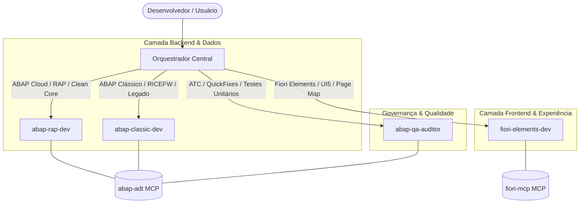

# Arquitetura Multiagente — SAP Full Stack (ABAP & Fiori)

Bem-vindo ao ambiente de desenvolvimento integrado para o ecossistema SAP. Este projeto adota uma arquitetura multiagente especializada que cobre o ciclo de vida completo de desenvolvimento: desde a modelagem de dados no backend (**ABAP Cloud / RAP** e **ABAP Clássico / RICEFW**) até a interface de usuário (**SAP Fiori Elements / SAPUI5**) e a auditoria de conformidade (**ABAP Test Cockpit / ATC**).

Todos os agentes seguem rigorosamente os padrões corporativos de desenvolvimento documentados em [padrao-desenvolvimento.md](padrao-desenvolvimento.md) e mapeados em [naming-conventions.json](naming-conventions.json).

---

## 🧭 Visão Geral dos Agentes



---

## 📋 Papéis e Especialidades

| Agente | Especialidade | Escopo de Atuação | Ferramentas MCP | Skill |
|---|---|---|---|---|
| **`abap-rap-dev`** | Backend Cloud & RAP | CDS View Entities (`ZI_*`, `ZC_*`), Metadata Extensions (`DDLX`), Behavior Definitions (`BDEF`), Classes de Comportamento (`ZCL<MD>_BP_*`), Value Helps e tabelas de banco/draft. | `abap-adt` | [SKILL.md](.agents/skills/abap-rap-dev/SKILL.md) |
| **`abap-classic-dev`** | ABAP Clássico & RICEFW | Reports (`PROG`), Includes (`_TOP`, `_SEL`, `_F01`), Function Groups/Modules (`FUGR/F`, `FUGR/FF`), BAPIs, Telas Dynpro (9000-9999), SE11 e estimativas de esforço. | `abap-adt` | [SKILL.md](.agents/skills/abap-classic-dev/SKILL.md) |
| **`fiori-elements-dev`** | Frontend Fiori & UI5 | Gerenciamento agnóstico de apps Fiori (LROP, ALP, OVP, FCL), Page Map no `manifest.json`, rotas, alvos, anotações XML locais e scripts UI5. | `fiori-mcp`, Terminal UI5/npm | [SKILL.md](.agents/skills/fiori-elements-dev/SKILL.md) |
| **`abap-qa-auditor`** | Qualidade & Governança | Execução de inspeções ATC, aplicação de QuickFixes automatizados, testes ABAP Unit e validação estática de código frontend (`eslint`). | `abap-adt`, Terminal | [SKILL.md](.agents/skills/abap-qa-auditor/SKILL.md) |

---

## 🎯 Quando Utilizar Cada Agente (Matriz de Decisão)

Utilize este guia rápido para saber qual agente acionar de acordo com o seu objetivo:

### 1. Criar ou Evoluir Serviços Modernos (Fiori / BTP / Clean Core)
* **Agente**: **`abap-rap-dev`**
* **Quando usar**:
  - Modelar novas entidades CDS (básicas, de composição ou de projeção).
  - Criar ou ajustar anotações de interface em Metadata Extensions (`@UI.lineItem`, `@UI.identification`, `@UI.facet`, `@UI.headerInfo`).
  - Configurar Value Helps padronizados (`@Consumption.valueHelpDefinition`) com validação semântica.
  - Implementar lógica transacional (validações, determinações, ações) em Behavior Pools.
  - Publicar serviços OData V4 (`SRVD` / `SRVB`).

### 2. Manutenção, Legado e Rotinas Batch
* **Agente**: **`abap-classic-dev`**
* **Quando usar**:
  - Desenvolver ou dar manutenção em relatórios executáveis (`Z..._REP`) e telas Dynpro clássicas.
  - Criar módulos de função RFC ou BAPIs customizadas para integração.
  - Manutenção em User Exits, BAdIs clássicas ou pontos de ampliação (Enhancements).
  - Configurar objetos tradicionais no dicionário SE11 (Search Helps `ZH*`, Lock Objects `EZ*`).
  - Estimar complexidade e horas de desenvolvimento para demandas RICEFW.

### 3. Ajustes de Telas, Navegação e Páginas Fiori
* **Agente**: **`fiori-elements-dev`**
* **Quando usar**:
  - Adicionar, alterar ou remover páginas no Page Map (List Report, Object Pages, Sub-Object Pages).
  - Configurar comportamento de tabelas (responsiva, grid, modo de criação `NewPage` vs `CreationDialog`).
  - Ajustar Flexible Column Layout (FCL) para visualização em múltiplas colunas.
  - Implementar Controller Extensions para comportamentos customizados na interface.
  - Executar validações de integridade e linter (`npm run lint`) no frontend.

### 4. Inspeção de Código e Homologação Técnica
* **Agente**: **`abap-qa-auditor`**
* **Quando usar**:
  - Antes de liberar uma Task/Request de desenvolvimento.
  - Executar a bateria de verificações do ABAP Test Cockpit (ATC) seguindo a variante corporativa.
  - Aplicar correções automáticas (QuickFixes) sugeridas pelo ADT.
  - Executar testes unitários automatizados (ABAP Unit).
  - Auditar aderência ao padrão de tolerância zero para erros do ATC.

---

## 💬 Como Utilizar no Dia a Dia (Exemplos de Prompts)

Você não precisa decorar comandos técnicos. Basta direcionar o pedido no chat de forma natural:

### Exemplos para `abap-rap-dev`:
```text
"Peça ao abap-rap-dev para adicionar um Value Help de clientes na entidade ZC_FS_TRAVEL usando a view padrão /DMO/I_Customer_StdVH."
```
```text
"Peça ao abap-rap-dev para ocultar os campos técnicos de UUID da metadata extension ZC_FS_BOOKING e reordenar as posições de 10 em 10."
```

### Exemplos para `fiori-elements-dev`:
```text
"Peça ao fiori-elements-dev para adicionar uma segunda Object Page para os itens de reserva no aplicativo Fiori."
```
```text
"Peça ao fiori-elements-dev para configurar a tabela do List Report como ResponsiveTable e rodar o linter."
```

### Exemplos para `abap-classic-dev`:
```text
"Peça ao abap-classic-dev para criar a estrutura do programa ZSD_RELATORIO_VENDAS com includes _TOP, _SEL e _F01 seguindo o cabeçalho oficial."
```
```text
"Peça ao abap-classic-dev para estimar uma demanda de Relatório ALV com complexidade média."
```

### Exemplos para `abap-qa-auditor`:
```text
"Peça ao abap-qa-auditor para rodar a inspeção ATC no pacote ZUI_FS_ABAP e relatar os apontamentos encontrados."
```
```text
"Peça ao abap-qa-auditor para verificar se o frontend e o backend possuem alguma pendência antes do transporte."
```

---

## 🔄 Fluxo de Trabalho Integrado (Ponta a Ponta)

Quando uma nova funcionalidade completa precisa ser entregue, o **Orquestrador Central** coordena os subagentes na ordem ideal de precedência:

```
[1. Planejamento] ──> [2. Backend RAP] ──> [3. Frontend Fiori] ──> [4. Auditoria QA] ──> [5. Entrega]
    Orquestrador         abap-rap-dev         fiori-elements-dev      abap-qa-auditor       Pronto
  (Plano aprovado)     (CDS/DDLX ativos)     (Page Map / Rotas)       (ATC 100% limpo)
```

1. **Orquestrador**: Avalia o requisito, consulta [naming-conventions.json](naming-conventions.json) e submete um plano de ação para sua confirmação.
2. **`abap-rap-dev`**: Implementa os objetos no backend, valida sintaxe (`abap_object_check`) e ativa no sistema SAP BTP.
3. **`fiori-elements-dev`**: Atualiza o descritor `manifest.json`, sincroniza navegações e valida o linter.
4. **`abap-qa-auditor`**: Dispara o ATC no backend, executa testes unitários e confirma que não existem desvios nem erros residuais.

---

## 📚 Documentos de Referência

- **[padrao-desenvolvimento.md](padrao-desenvolvimento.md)**: Manual normativo corporativo de desenvolvimento SAP (Módulos, Pacotes, Requests, Dicionário SE11, ABAP OO, CDS, Fiori e Regras de ATC).
- **[naming-conventions.json](naming-conventions.json)**: Mapeamento técnico estruturado em JSON com todos os prefixos e padrões de nomenclatura.
- **[AGENTS.md](AGENTS.md)**: Declaração dos papéis e configurações dos agentes suportados pelo Antigravity.
- **[CLAUDE.md](CLAUDE.md)**: Instruções do orquestrador para o Claude Code (importa o AGENTS.md).

---

## 🤖 Suporte a Ferramentas

| Item | Antigravity | Claude Code | Kimi Code (3.x) | Codex |
|---|---|---|---|---|
| Instruções do orquestrador | `AGENTS.md` | `CLAUDE.md` (importa `AGENTS.md`) | `.kimi-code/agents/orquestrador.md` (+ `AGENTS.md`) | `AGENTS.md` + `developer_instructions` em `.codex/config.toml` |
| Subagentes | Declarados no `AGENTS.md` | `.claude/agents/*.md` | `.kimi-code/agents/*.md` | `.codex/agents/*.toml` |
| Skills | `.agents/skills/*/SKILL.md` | `.claude/skills/*/SKILL.md` | `.agents/skills/*/SKILL.md` (lido nativamente) | `.agents/skills/*/SKILL.md` (lido nativamente) |
| Servidores MCP | `.agents/mcp_config.json` | `.mcp.json` | `.kimi-code/mcp.json` | `.codex/config.toml` |

No Claude Code, use `/agents` para ver os subagentes e `/mcp` para conferir a conexão dos servidores. Os prompts de exemplo acima ("Peça ao abap-rap-dev...") funcionam igual. Ao alterar uma skill, replique a mudança nas duas pastas.

No Kimi Code, inicie com `kimi --agent orquestrador`. **A flag é necessária**: o Kimi não lê o `CLAUDE.md`, que no Claude Code é o que transforma a sessão principal em orquestrador. Sem a flag, a sessão usa o agente padrão e **não aplica as regras de orquestração** (plano com aprovação, delegação, ordem backend → Fiori → QA e ATC obrigatório). Defina antes `ABAP_ADT_TOKEN` no ambiente; o `mcp.json` usa `bearerTokenEnvVar`, sem token no arquivo). Use `/mcp` para conferir os servidores. O Kimi pede confiança no workspace na primeira vez, pois o `mcp.json` do projeto executa comandos.

No Codex, abra o projeto na raiz e marque-o como confiável (o `.codex/config.toml` do projeto só é lido em projetos trusted). Defina `ABAP_ADT_TOKEN` no ambiente; o `config.toml` usa `bearer_token_env_var`. As regras de orquestração estão em `developer_instructions` (o Codex não lê o `CLAUDE.md`). Os subagentes só são acionados quando você pedir explicitamente ("use o subagente abap-rap-dev..."). Use `/mcp` e `/agent` para conferir.

---

## 🔑 Configuração do Token MCP (`abap-adt`)

O token do servidor `abap-adt` **não é versionado**. Cada desenvolvedor configura o seu:

1. Copie `.env.example` para `.env` e preencha `ABAP_ADT_TOKEN` (o `.env` está no `.gitignore`).
2. **Claude Code**: o `.mcp.json` lê `${ABAP_ADT_TOKEN}` das variáveis de ambiente do sistema — ele **não carrega o `.env` sozinho**. Defina a variável antes de abrir o Claude Code:
   - **Windows (PowerShell, permanente)**: `[Environment]::SetEnvironmentVariable('ABAP_ADT_TOKEN','<SEU_TOKEN>','User')` e reinicie o terminal.
   - **Windows (sessão atual)**: `$env:ABAP_ADT_TOKEN = '<SEU_TOKEN>'` e então inicie o `claude`.
   - **macOS / Linux (zsh, permanente)**: `echo "export ABAP_ADT_TOKEN='<SEU_TOKEN>'" >> ~/.zshrc` e abra um terminal novo (no bash, use `~/.bashrc`).
   - **macOS / Linux (sessão atual)**: `export ABAP_ADT_TOKEN='<SEU_TOKEN>'` e então inicie o `claude`.
   - No macOS, inicie o Claude Code **pelo terminal** (`claude`). Apps abertos pelo ícone não enxergam o `~/.zshrc`.
3. **Antigravity**: substitua `<SEU_TOKEN>` em `.agents/mcp_config.json` apenas na sua cópia local, **sem fazer commit** desse valor.
4. Confirme a conexão com `/mcp` (Claude Code).

### ⚠️ Usando no macOS / Linux: ajuste o `fiori-mcp`

O `.mcp.json` do repositório está configurado para **Windows**: o servidor `fiori-mcp` usa o wrapper `cmd /c`, que não existe no macOS/Linux. Na sua cópia local, troque o bloco `fiori-mcp` por:

```json
"fiori-mcp": {
  "type": "stdio",
  "command": "npx",
  "args": ["--yes", "@sap-ux/fiori-mcp-server@1.15.19", "fiori-mcp"],
  "env": {}
}
```

Requer Node.js/npm instalado. Não faça commit dessa alteração, para não quebrar a configuração dos usuários Windows. O servidor `abap-adt` (HTTP em `localhost:2236`) não muda, desde que o ADT MCP esteja rodando na sua máquina.

> Nunca grave o token real em arquivos versionados. O `.env` serve de referência local; o `.env.example` documenta o formato.

---

## 📁 As pastas `.agents`, `.claude`, `.kimi-code` e `.codex` 

Todas contêm a mesma configuração dos agentes; o que muda é **qual ferramenta de IA lê cada pasta**. Pastas iniciadas por ponto ficam ocultas por padrão no Explorer — ative "Itens ocultos" para vê-las.

### `.agents/` — Antigravity

| Conteúdo | O que é |
|---|---|
| `skills/<agente>/SKILL.md` | Instruções detalhadas de cada especialista (regras, nomenclatura, fluxo de trabalho). |
| `mcp_config.json` | Servidores MCP (`abap-adt`, `fiori-mcp`) usados pelo Antigravity. |
| `naming-conventions.json` | Cópia do mapeamento de nomenclatura consumida pelas skills. |

**Quando usar**: ao trabalhar no **Antigravity**. Os subagentes são declarados no `AGENTS.md` da raiz e cada um aponta para sua skill aqui.

### `.claude/` — Claude Code

| Conteúdo | O que é |
|---|---|
| `agents/<agente>.md` | Definição de cada **subagente** (nome, descrição de quando acionar, ferramentas permitidas). Carrega a skill correspondente. |
| `skills/<agente>/SKILL.md` | Mesmo conteúdo das skills de `.agents/skills/`. |
| `settings.local.json` | Permissões e preferências **locais** do usuário (não compartilhe/versione). |

**Quando usar**: ao trabalhar no **Claude Code**. A sessão principal age como Orquestrador (via `CLAUDE.md`) e delega aos subagentes de `.claude/agents/`. Os MCPs vêm do `.mcp.json` da raiz.

### `.kimi-code/` — Kimi Code

| Conteúdo | O que é |
|---|---|
| `agents/<agente>.md` | Subagentes (mesmo conteúdo de `.claude/agents/`, sem o campo `skills`; cada um manda carregar a skill correspondente). |
| `agents/orquestrador.md` | Agente principal com as regras de orquestração do `CLAUDE.md`. |
| `mcp.json` | Servidores MCP do projeto. |

As skills **não** são duplicadas: o Kimi lê `.agents/skills/` direto. Novo agente? Crie também `.kimi-code/agents/<nome>.md`.

### `.codex/` — Codex

| Conteúdo | O que é |
|---|---|
| `agents/<agente>.toml` | Subagentes (mesmo conteúdo de `.kimi-code/agents/`, em formato TOML; cada um manda carregar a skill correspondente). |
| `config.toml` | Servidores MCP, limites de subagentes e `developer_instructions` com as regras do orquestrador. |

**Quando usar**: ao trabalhar no **Codex**. As skills **não** são duplicadas: o Codex lê `.agents/skills/` direto. Novo agente? Crie também `.codex/agents/<nome>.toml`.

### Os subagentes são obrigatórios?

**Não.** Eles são uma opção para tarefas maiores; tarefas pequenas podem ser pedidas direto ao orquestrador (sessão principal).

- **Forçar um subagente**: cite o nome no pedido ("Peça ao `abap-rap-dev`...").
- **Evitar a delegação**: diga "faça você mesmo, sem subagente". Sem instrução, o Claude Code pode delegar sozinho quando o pedido combina com a especialidade (as descrições dos agentes indicam uso proativo).
- **Regras que valem sempre** (com ou sem subagente): apresentar o plano com os nomes dos objetos para aprovação antes de criar/alterar algo no SAP, e só concluir a entrega com ATC sem erros pelo `abap-qa-auditor`.

| Vale delegar | Não vale delegar |
|---|---|
| Entregas ponta a ponta (backend → Fiori → QA) | Ajustes de uma ou duas linhas |
| Trabalho com muita saída (ATC, logs extensos), que fica fora do contexto principal | Consultas e dúvidas |
| Etapas independentes, que podem rodar em paralelo | Tarefas em que o contexto da conversa importa (o subagente só conhece o que está no prompt) |

No **Antigravity**, os "subagentes" são papéis declarados no `AGENTS.md` apontando para as skills; também não é obrigatório acioná-los pelo nome.

### Regras de manutenção

- **Não é preciso escolher uma pasta**: mantenha as duas no projeto; cada ferramenta usa a sua.
- **Alterou uma skill? Replique** em `.agents/skills/` e `.claude/skills/` para que as duas ferramentas continuem com o mesmo comportamento.
- **Novo agente?** Crie a skill nas duas pastas, o `.claude/agents/<nome>.md`, o `.kimi-code/agents/<nome>.md`, o `.codex/agents/<nome>.toml` e registre-o no `AGENTS.md` e no `CLAUDE.md`.
- **Padrões corporativos** (`padrao-desenvolvimento.md`, `naming-conventions.json`) ficam na raiz e são a fonte única de verdade — não duplique regras dentro das skills.

---

## 🤝 Contribuidores

Quem contribuir deve registrar a atividade em [CONTRIBUTORS.md](CONTRIBUTORS.md) (uma linha por contribuição).
