# Primeiros passos

Guia para quem vai **usar** o projeto no dia a dia: um desenvolvedor ABAP que recebeu o repositório e quer sair do zero até o primeiro objeto criado pelos agentes. Se você vai **manter o template** (editar agentes, skills e MCPs), leia depois a seção [Estrutura](../README.md#-estrutura-fonte-única--adaptadores-gerados) do README.

> **Começando agora com ABAP e IA?** Três páginas curtas ajudam:
> - [Glossário](glossario.md): os termos do projeto (MCP, orquestrador, SID, ATC, RAP...) em linguagem simples.
> - [Parece erro, mas é normal](parece-erro-mas-e-normal.md): as recusas e mensagens que assustam, mas são de propósito.
> - [Como revisar o plano antes de aprovar](revisar-o-plano.md): as 8 perguntas para fazer antes de deixar a IA criar objetos.

Tempo estimado: uns 15 minutos com o assistente (etapa 3), sem contar a espera pelas liberações da etapa 1.

---

## Como funciona, em uma frase

Você conversa com uma ferramenta de IA (Claude Code, Codex, Kimi ou Antigravity) aberta na pasta deste projeto. Ela atua como **orquestrador**: entende o pedido, apresenta um plano com os nomes dos objetos, espera a sua aprovação e então cria os objetos no SAP pelos servidores **MCP**, que dão à IA acesso ao ADT. No fim, o ATC precisa sair sem erros.

---

## 1. Antes de começar: o que pedir a outras pessoas

Estes itens não dependem de você. Peça logo no início, porque costumam demorar.

| Pedir a | O quê | Para quê |
|---|---|---|
| Gestor do projeto / cliente | SID e mandante do **DEV**, sigla do cliente, variante ATC, projeto CTS (se o cliente atribuir projeto às requests), namespace Fiori | Responder ao assistente (etapa 3) |
| Gestor do projeto / cliente | **Aceite formal** para usar `vsp`/`arc-1`, se o sistema for S/4HANA 2023 ou inferior | A SAP classifica as APIs ADT como internas ([política, seção 7](../standards/politica-mcp-abap.md)) |
| Basis | URL **HTTPS** do ICM (ex.: `https://host:44300`) | Conectar ao SAP. O release não precisa ser informado: o assistente o detecta |
| Basis | Serviço ICF `/sap/bc/adt` ativo | Sem ele, nenhum MCP conecta |
| Basis | Conferir o **SHA-256 do certificado** HTTPS (STRUST), se ele for autoassinado; ou a CA raiz em `.pem`, se for de CA interna | O assistente mostra o SHA-256 antes de confiar no certificado ([ADR-0013](adr/0013-certificado-fixado-e-tls-do-vsp.md)) |
| Segurança SAP | Usuário de DEV com autorizações de desenvolvedor ADT, restritas aos pacotes do projeto | Os agentes criam e ativam objetos com esse usuário |
| Segurança SAP | Autorização de **data preview na T000** para esse usuário | O launcher lê a T000 para saber se o sistema é DEV, QAS ou PRD. Sem ela, o sistema é tratado como PRD e o launcher recusa conectar |
| Segurança SAP | Usuário **somente leitura** no QAS (opcional) | Análise com o `arc-1` |
| Responsável pela ferramenta de IA | Acesso/licença da ferramenta (Claude Code, Codex etc.) | Usar o orquestrador |

> Use **sempre** um usuário restrito ao DEV para desenvolvimento. O projeto tem várias travas, mas a autorização SAP é a última barreira.

---

## 2. Preparar a máquina (uma vez)

1. **Git** — para clonar o repositório. Confira com `git --version`.
2. **Node.js 22.19 ou superior** — usado pelo launcher dos MCPs e pelo `fiori-mcp`. Confira com `node -v`. Se precisar, instale a versão LTS de [nodejs.org](https://nodejs.org).
3. **Só para S/4HANA 2025+: o ADT**, no Eclipse (ADT for Eclipse) ou no VS Code (extensão ADT for Visual Studio Code). É ele que traz o servidor `abap-adt` (etapa 4).
4. **A ferramenta de IA.** Para o Claude Code, siga a [documentação oficial de instalação](https://docs.claude.com/en/docs/claude-code/setup). Para as outras, veja [Suporte a Ferramentas](../README.md#-suporte-a-ferramentas) no README.
5. **Clonar o repositório:**

   ```powershell
   git clone -b <BRANCH> <URL_DO_REPOSITORIO_TEMPLATE> <PASTA_PROJETO>
   cd <PASTA_PROJETO>
   git remote rename origin template
   git remote add origin <URL_DO_REPOSITORIO_PROJETO>
   ```

---

## 3. Configurar com o assistente

Na raiz do projeto:

```powershell
node scripts/setup.mjs
```

O assistente:

1. Confere o Node, cria o `.env` a partir do `.env.example` e, no macOS/Linux, gera os arquivos de MCP sem o `cmd /c`.
2. Para o **DEV** (e, se você quiser, o **QAS**; o PRD não é configurado), pede só URL, mandante, usuário e senha. A senha não aparece na tela.
3. Conecta no SAP e mostra o que detectou: SID, release e ambiente. Você não precisa saber o release antes. Se a URL do DEV apontar para um QAS, ele avisa antes de gravar. Se o certificado HTTPS não for confiável, ele o baixa, mostra o SHA-256 para você conferir com o Basis e o fixa na conexão.
4. Grava a conexão no `.env`, com o SID detectado como conferência.
5. Pede os parâmetros do cliente e grava no bloco `cliente` de [standards/naming-conventions.json](../standards/naming-conventions.json) e nos placeholders de [standards/padrao-desenvolvimento.md](../standards/padrao-desenvolvimento.md). O `sistemaDesenvolvimento` vem do SID detectado no DEV, sem digitar. Se outra pessoa já adotou o template para este cliente, ele só confirma os valores.
6. Em S/4HANA 2025+, oferece gravar o `ABAP_ADT_TOKEN` nas variáveis do usuário (como obter o token: etapa 4). Se nenhum sistema for detectado na execução, pergunta se o cliente tem 2025+.
7. Roda o **doctor**, que confere Node, arquivos gerados, testes das travas, parâmetros do cliente e cada conexão, e diz o que fazer em cada falha.

Senhas e token ficam só na sua máquina: o assistente é um script local e não passa nada pela ferramenta de IA. Nada é gravado sem a sua confirmação. Depois de alterar o `.env` ou uma variável do usuário, **feche e abra de novo** o terminal e a ferramenta de IA.

Para refazer uma etapa: `node scripts/setup.mjs --apenas=dev` (ou `qas`, `cliente`, `token`, separados por vírgula). Para só conferir, a qualquer momento: `node scripts/doctor.mjs`.

**O que o assistente decide pelo release detectado:**

| Release | Servidor MCP do DEV | O que falta depois do assistente |
|---|---|---|
| S/4HANA 2025 ou superior (SAP_BASIS ≥ 816) | `abap-adt` (MCP oficial SAP) | Habilitar o servidor MCP no ADT e gravar o token (etapa 4) |
| S/4HANA 2023 ou inferior (SAP_BASIS 750 a 815) | `vsp` (e `arc-1` no QAS) | Nada: o launcher baixa o `vsp` e o ARC-1 sozinho |
| Anterior ao NetWeaver 7.50 | — | Fora do escopo do projeto |

### Sem o assistente

Se preferir configurar à mão, faça o mesmo que o assistente faz:

1. **Crie o `.env`** a partir do modelo: `Copy-Item .env.example .env`. Ele está no `.gitignore` e é lido só pelo launcher do `vsp` e do `arc-1`.
2. **Preencha a conexão do DEV** (e, se for usar, a do QAS). Informe só a conexão: SID, release e ambiente são detectados no próprio SAP.

   ```ini
   VSP_SAP_URL=https://ds4.cliente.com.br:44300
   VSP_SAP_CLIENT=110
   VSP_SAP_USER=SEU_USUARIO
   VSP_SAP_PASSWORD=...
   VSP_ALLOWED_PACKAGES=$TMP,Z*

   ARC1_QAS_SAP_URL=https://qs4.cliente.com.br:44300
   ARC1_QAS_SAP_CLIENT=400
   ARC1_QAS_SAP_USER=USUARIO_LEITURA
   ARC1_QAS_SAP_PASSWORD=...
   ```

   Não há conexão para o PRD: nenhum servidor acessa o ambiente produtivo.
3. **Preencha os parâmetros do cliente:**
   - no bloco `cliente` de [standards/naming-conventions.json](../standards/naming-conventions.json): empresa, sigla, variante ATC, namespace Fiori, pasta dos apps e `sistemaDesenvolvimento` (SID do DEV);
   - em `requests.projetoCTS`, o projeto CTS; se o cliente não atribui projeto às requests, use `"não se aplica: este cliente não atribui projeto CTS às requests"`;
   - em [standards/padrao-desenvolvimento.md](../standards/padrao-desenvolvimento.md), os placeholders `<VARIANTE_ATC>`, `<PROJETO_CTS>`, `<ID_PROJETO_CTS>`, `<DESCRICAO_PROJETO_CTS>` e `[EMPRESA]`.

   Enquanto houver `<...>`, os agentes perguntam em vez de supor.
4. **Confira** com `node scripts/doctor.mjs`. Se ele acusar certificado não confiável (`DEPTH_ZERO_SELF_SIGNED_CERT`), rode `node scripts/setup.mjs --apenas=dev` (ou `qas`) só para fixar o certificado: é o único passo que exige o assistente, porque ele mostra o SHA-256 para você conferir.

Todas as variáveis opcionais (transportes, versões do `vsp`/ARC-1, fallback de 2025+) estão comentadas no próprio `.env.example`.

---

## 4. S/4HANA 2025+: habilitar o `abap-adt`

Só se o release detectado for S/4HANA 2025 ou superior. O servidor `abap-adt` é o MCP oficial da SAP, embutido no **ADT** (ABAP Development Tools), tanto no **Eclipse** quanto no **Visual Studio Code**. Use a IDE com que você já trabalha. O projeto espera o servidor em **`http://localhost:2236/mcp`**, e a IDE precisa ficar **aberta e conectada ao DEV** enquanto você usa os agentes.

> A SAP marca o servidor MCP do ADT como **recurso experimental**: pode mudar sem aviso e não se destina a uso produtivo. Os nomes dos menus abaixo podem variar um pouco conforme a versão do ADT.

### 4.1 Habilitar o servidor e obter o token — Eclipse

Pré-requisitos: ADT for Eclipse **3.60 ou superior** (confira em *Help → About Eclipse IDE → Installation Details*) e o projeto ABAP do DEV aberto e logado no *Project Explorer*, com *Save password* marcado.

1. Abra **Window → Preferences → ABAP Development → MCP Server**.
2. Marque **Enable ADT MCP Server**.
3. Em **Port**, informe **2236**. O padrão do Eclipse é 2234, mas os arquivos de MCP do projeto usam 2236 (o mesmo padrão do VS Code).
4. Em **Token**, clique em **Generate** e copie o valor.
5. Clique em **Apply**. Deve aparecer a mensagem *ADT MCP Server started successfully*.
6. **Para o servidor subir sozinho** quando o Eclipse abrir, acrescente na **última linha** do `eclipse.ini` (pasta de instalação do Eclipse, depois do bloco `-vmargs`):

   ```
   -DadtMcpServerPrefEnabled=true
   ```

   Sem essa linha, o servidor só roda enquanto a preferência estiver aplicada na sessão atual do Eclipse.
7. Se o servidor não aparecer, confira em *Window → Show View → Error Log*.

### 4.2 Habilitar o servidor e obter o token — VS Code

Pré-requisitos: extensão **ADT for Visual Studio Code** conectada ao DEV e a **destination** do sistema no workspace (`ABAP: Add Destination as Folder to the Workspace...`). O servidor só inicia com uma destination ativa e logada.

> As capturas de tela desta seção são do exercício oficial da SAP [abap-platform-rap130](https://github.com/SAP-samples/abap-platform-rap130/blob/main/exercises/ex01/README.md) (licença Apache-2.0). Os valores `RAP130` e `ZRAP130_000` são do exercício: no seu caso, use a destination do DEV e os pacotes do projeto.

1. `Ctrl+Shift+P` (macOS: `Cmd+Shift+P`) → `Preferences: Open Settings (UI)` e pesquise `adt mcp`. As opções ficam em *Extensions → ABAP Development*.

   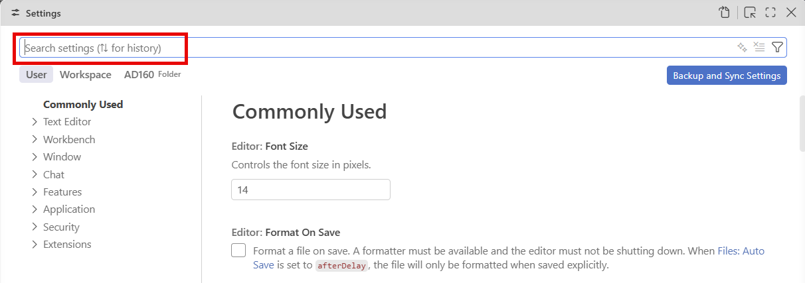

2. Marque **Adt › Mcp Server: Enabled** (*Enable ADT MCP Server*). No JSON de configurações, o equivalente é `"adt.mcpServer.enabled": true`.

   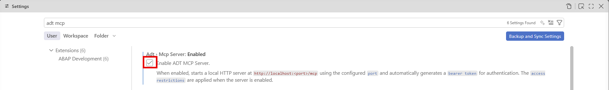

3. **Porta:** deixe **2236**, o padrão, que é o mesmo do projeto.

   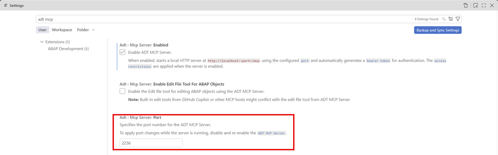

4. Recarregue o VS Code, se ele pedir. Deve aparecer `ADT MCP Server running on port 2236` no canto inferior direito.

   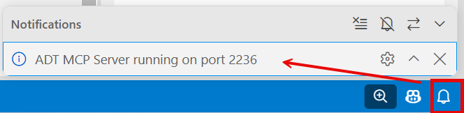

   Também dá para conferir em `Ctrl+Shift+P` → `MCP: List Servers` (e **Start Server**, se estiver parado).

   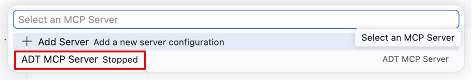

5. Copie o **token** em **Adt › Mcp Server: Token**, na mesma tela. Ele é gerado quando o servidor inicia (na primeira vez, pode levar alguns segundos); não o edite à mão.

   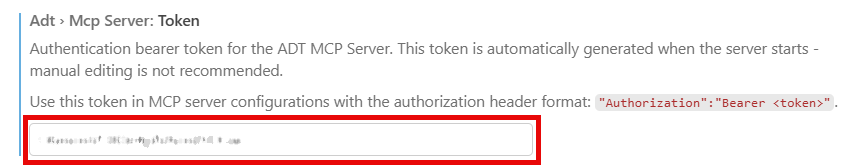

### 4.3 Permitir edição e restringir o acesso

Para os agentes **criarem e alterarem** objetos pelo `abap-adt`, a ferramenta de edição precisa estar ligada, e o acesso precisa ficar restrito ao DEV e aos pacotes do projeto ([política, seção 4.1](../standards/politica-mcp-abap.md)):

| Configuração | VS Code | O que pôr |
|---|---|---|
| Ferramenta de edição | **Adt › Mcp Server: Enable Edit File Tool For ABAP Objects** | Marcada. É ela que permite a agentes de linha de comando, como o Claude Code, editar objetos ABAP. |
| Ligar as restrições | **Adt › Mcp Server: Access Restrictions Enabled** | Marcada (`adt.mcpServer.accessRestrictionsEnabled = true`). Desmarcada, tudo é permitido. |
| Restrições | **Adt › Mcp Server: Access Restrictions** → `destinations` e `packages-objectChanges` (ícone de edição) | Em `destinations`, só a do **DEV** (e a do **QAS**, se for analisar por lá). Em `packages-objectChanges`, só os pacotes do projeto (ex.: `$TMP,Z<SIGLA>*`). Cada campo aceita uma lista separada por vírgula. **Nenhuma destination de PRD.** |

A restrição de pacotes vale só para **criar e alterar** objetos nas destinations permitidas; a leitura não é limitada por ela.

1. Marque a ferramenta de edição:

   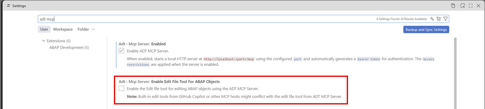

2. Marque **Access Restrictions Enabled**:

   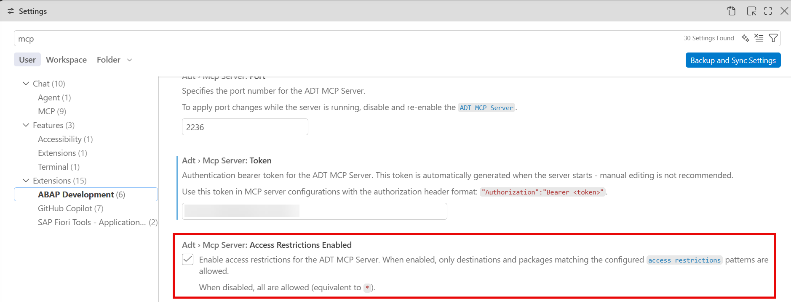

3. Em **Access Restrictions**, edite `destinations` com a destination do DEV:

   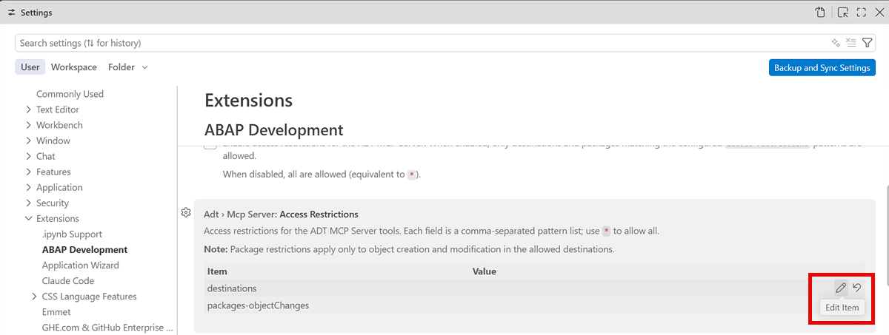

4. Edite `packages-objectChanges` com os pacotes do projeto:

   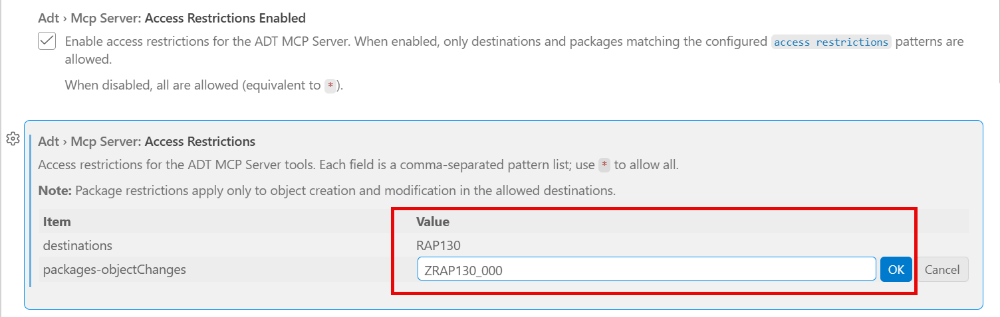

5. Resultado esperado (no exemplo, a destination `RAP130` e o pacote `ZRAP130_000`):

   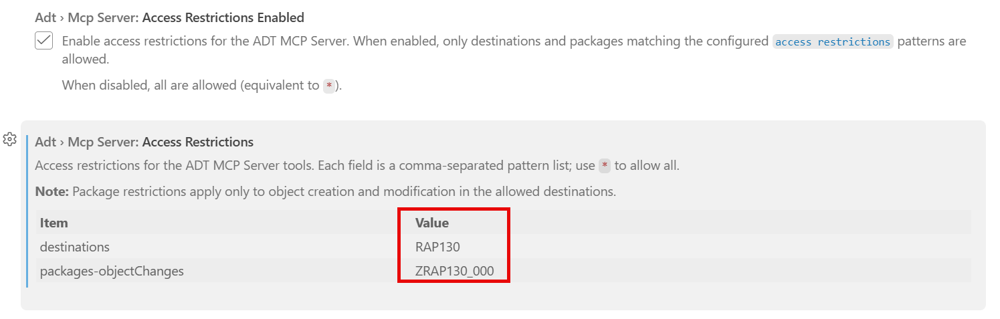

No Eclipse, procure as opções equivalentes na mesma página **ABAP Development → MCP Server**: ferramenta de edição de objetos ABAP e restrições de acesso por destination e pacote. Os critérios são os mesmos: DEV (e QAS, se for analisar), alterações só nos pacotes do projeto e nenhum PRD.

### 4.4 Gravar o token

O token vai para a variável `ABAP_ADT_TOKEN`, nas **variáveis do usuário**, e **não** no `.env`: Claude Code, Codex e Kimi leem o token do ambiente e não carregam o `.env`. Os arquivos de MCP do projeto já declaram o `abap-adt` com o header `Authorization: Bearer ${ABAP_ADT_TOKEN}`.

Com o assistente (recomendado, o token não aparece ao digitar):

```powershell
node scripts/setup.mjs --apenas=token
```

À mão:

| Sistema | Comando |
|---|---|
| Windows (permanente) | `[Environment]::SetEnvironmentVariable('ABAP_ADT_TOKEN','<SEU_TOKEN>','User')` |
| Windows (só esta sessão) | `$env:ABAP_ADT_TOKEN = '<SEU_TOKEN>'` |
| macOS / Linux (zsh, permanente) | `echo "export ABAP_ADT_TOKEN='<SEU_TOKEN>'" >> ~/.zshrc` (no bash, `~/.bashrc`) |
| macOS / Linux (só esta sessão) | `export ABAP_ADT_TOKEN='<SEU_TOKEN>'` |

Depois, **feche e abra o terminal e a ferramenta de IA**. No macOS, abra a ferramenta pelo terminal: apps abertos pelo ícone não enxergam o `~/.zshrc`. No Antigravity, substitua `<SEU_TOKEN>` em `.agents/mcp_config.json` só na sua cópia local, sem commit.

- **Não use `claude mcp add`**, como aparece em guias de workshop: o servidor já está declarado no projeto, e registrá-lo de novo duplicaria o `abap-adt` com o token gravado em texto claro na configuração do Claude Code.
- **Se gerar um token novo** na IDE, grave de novo com `node scripts/setup.mjs --apenas=token`.

### 4.5 Conferir e problemas comuns

Rode `node scripts/doctor.mjs`. A seção `abap-adt` deve mostrar o token definido e o servidor respondendo em `localhost:2236`.

| Sintoma | O que fazer |
|---|---|
| `/mcp` ou o `doctor` mostram `ECONNREFUSED` no `abap-adt` | A IDE está fechada, o servidor MCP não está habilitado, ou a porta não é 2236. No Eclipse, confira a porta (o padrão dele é 2234) e o `-DadtMcpServerPrefEnabled=true`. |
| O servidor não inicia (VS Code) | Desmarque e marque **Adt › Mcp Server: Enabled**; remova a pasta da destination do workspace e adicione de novo; reinicie o VS Code. |
| O servidor não inicia (Eclipse) | Confira se **Enable ADT MCP Server** está marcado e se você clicou em **Apply**; veja o *Error Log*; reinicie o Eclipse. |
| `401` / não autorizado | O token não confere com o da IDE. Copie de novo e rode `node scripts/setup.mjs --apenas=token`; depois reinicie a ferramenta de IA. |
| `Unable to initialize the ADT Discovery` (Eclipse) | Faça logon no projeto ABAP no *Project Explorer* e marque *Save password*. |
| O `doctor` diz que o token está nas variáveis do usuário, mas não no terminal | Feche e abra o terminal e a ferramenta de IA. |
| O agente não consegue editar objetos | A ferramenta de edição (4.3) está desligada, ou o pacote não está nas restrições de acesso. |

**Operação que o `abap-adt` não oferece:** a SAP ainda não entregou no MCP oficial todas as operações de desenvolvimento. Se o orquestrador mostrar que falta uma, a política prevê usar o `vsp` (e depois o `arc-1`) no mesmo DEV, **só para essa operação**:

1. Confira a evidência que o orquestrador mostra (a ferramenta consultada ou o erro literal). Erro de sintaxe, objeto bloqueado, autorização ou timeout **não** são motivo.
2. Preencha `VSP_*` com o mesmo DEV (etapa 3) e descomente no `.env` a linha `VSP_FALLBACK_2025=true`.
3. Reinicie a ferramenta de IA e confirme a operação quando o orquestrador pedir.
4. Ao terminar, comente a linha de novo e reinicie a ferramenta.

Detalhes e o 2º passo da cadeia (`arc-1`): [Fallback do `abap-adt`](setup-mcp-abap.md#fallback-do-abap-adt-em-s4hana-2025).

**Fontes:** [Enabling ADT MCP Server](https://help.sap.com/docs/abap-ai/generative-ai-in-abap-cloud/enabling-adt-mcp-server-6f6e72852b9746ffbe083d5a818fbbec?locale=en-US) (SAP Help, Eclipse); [Agentic AI for ABAP Development](https://help.sap.com/docs/abap-cloud/abap-development-tools-for-visual-studio-code/agentic-ai-development?locale=en-US) e [ADT MCP Tools](https://help.sap.com/docs/abap-cloud/abap-development-tools-for-visual-studio-code/mcp-tools?locale=en-US) (SAP Help, VS Code); [SAP-samples/abap-platform-rap130, exercício 1](https://github.com/SAP-samples/abap-platform-rap130/blob/main/exercises/ex01/README.md); [workshop SITFOR 2026, exercício 1, parte A](https://github.com/lucianocasado88/sitfor2026-abap-ai/blob/main/exercises/ex01/README.md#parte-a-adt-mcp-server); [arc1-adt-abap-mcp-ext](https://github.com/arc-mcp/arc1-adt-abap-mcp-ext) (comunidade, descreve a página de preferências do Eclipse).

---

## 5. Abrir a ferramenta e conferir as conexões

1. Abra a ferramenta **na raiz do projeto** (a pasta que contém o `AGENTS.md`). Aberta numa subpasta, os MCPs `vsp` e `arc-1` não sobem.

   ```powershell
   cd <PASTA_PROJETO>
   claude
   ```

2. No Claude Code, digite `/mcp`. Devem aparecer conectados:
   - `fiori-mcp`, sempre;
   - `abap-adt` (S/4HANA 2025+) **ou** `vsp` (S/4HANA 2023 ou inferior);
   - `arc-1-qas`, se você configurou o QAS.

   Um servidor que você não configurou aparece como falho. Isso é esperado (ex.: `abap-adt` falho num cliente só com S/4HANA 2023).

3. Digite `/agents`. Devem aparecer `abap-rap-dev`, `abap-classic-dev`, `fiori-elements-dev` e `abap-qa-auditor`.

---

## 6. Primeiro teste de ponta a ponta

Faça este teste antes de usar o projeto em uma demanda real. Ele confirma a leitura, a criação, a ativação e o ATC.

**Passo 1 — Leitura (não altera nada):**

```text
Qual é o SID, o release e o ambiente do sistema conectado? Depois, mostre a definição da tabela T001.
```

Esperado: o orquestrador informa o servidor MCP usado, o SID e o ambiente (`DEV`), e mostra os campos da T001. Confira se o SID é o do DEV.

**Passo 2 — Criação de um objeto local:**

```text
Crie uma classe local de teste YCL_TESTE_AGENTE no pacote $TMP, com um método que retorna a data atual. Depois rode o ATC nela.
```

Esperado, nesta ordem:

1. O orquestrador apresenta um **plano** com o nome do objeto e **pede sua aprovação**. Nada é criado antes disso. Aproveite para treinar o [checklist de revisão do plano](revisar-o-plano.md).
2. Ele confirma que o SID conectado é o `sistemaDesenvolvimento` do bloco `cliente`.
3. A classe é criada e **ativada**.
4. O `abap-qa-auditor` roda o ATC e relata o resultado.

**Passo 3 — Conferir no SAP:** abra a classe no Eclipse/ADT ou na SE24 e confira. Depois, apague-a manualmente.

Se os três passos funcionaram, a instalação está completa.

---

## 7. No dia a dia

- **Peça em linguagem natural.** Exemplos por agente em [Como Utilizar no Dia a Dia](../README.md#-como-utilizar-no-dia-a-dia-exemplos-de-prompts).
- **Informe o contexto da demanda:** módulo (`SD`, `MM`...), GAP, pacote e request. O que você não informar, o orquestrador pergunta.
- **Leia o plano antes de aprovar.** Os nomes seguem o [padrão de nomenclatura](../standards/naming-conventions.json), mas a decisão é sua. Use o [checklist de revisão do plano](revisar-o-plano.md).
- **Tarefas pequenas** (uma ou duas linhas, consultas) podem ser feitas direto, sem subagente. Para forçar um especialista, cite o nome: "Peça ao `abap-rap-dev`...".

Regras que valem sempre e que você vai notar:

| Regra | O que acontece |
|---|---|
| Plano antes de alterar | Nada é criado ou alterado no SAP sem a sua aprovação |
| Só no DEV | Se o SID conectado não for o DEV do bloco `cliente`, o agente para e avisa |
| QAS é somente leitura e o PRD não é acessado | Com qualquer servidor, nem para leitura no PRD (ADR-0014). ABAP Unit também só roda em DEV/SANDBOX |
| ATC sem erros | Uma entrega só é concluída quando o ATC não tem erros |
| Relato fiel | O agente informa o sistema e o servidor usados, e o que foi recusado pela política |

---

## 8. Quando algo der errado

| Sintoma | O que fazer |
|---|---|
| Qualquer problema de configuração | Rode `node scripts/doctor.mjs`: ele mostra o que falhou e o que fazer |
| Servidor falho no `/mcp`, mas o `doctor` passa | Abra a ferramenta na raiz do projeto e reinicie-a depois de mudar o `.env` ou uma variável do usuário |
| Problema no `abap-adt` | Veja a etapa 4.5 |
| `vsp` recusado por ser QAS ou PRD | A URL aponta para outro sistema, ou o usuário não tem data preview na T000 |
| O agente pergunta sigla, pacote ou variante toda hora | Há placeholders `<...>` no bloco `cliente`: rode `node scripts/setup.mjs --apenas=cliente` |
| O agente se recusa a criar objetos | Confira na mensagem o SID encontrado. Ele só cria no `sistemaDesenvolvimento` |
| Qualquer mensagem `mcp-launch:` | Consulte [Problemas comuns](setup-mcp-abap.md#problemas-comuns) |

Recusas da IA ou do launcher que parecem defeito, mas são de propósito, estão explicadas em [Parece erro, mas é normal](parece-erro-mas-e-normal.md).

Se nada resolver, rode `node scripts/mcp-launch.mjs <servidor> --diagnostico` e envie a saída a quem mantém o projeto, **sem** senhas ou tokens.
