# Padrão de Desenvolvimento

## Sumário

1. [Controle](#1-controle)
2. [Visão Geral](#2-visão-geral)
3. [Fluxo de desenvolvimento](#3-fluxo-de-desenvolvimento)
4. [Módulos SAP (MD)](#4-módulos-sap-md)
5. [Pacote](#5-pacote)
6. [Requests](#6-requests)
7. [Objetos Reutilizáveis](#7-objetos-reutilizáveis)
8. [Regras de nomenclatura ABAP](#8-regras-de-nomenclatura-abap)
9. [Criação do APP no BAS e VSCode](#9-criação-do-app-no-bas-e-vscode)
10. [Core Data Source (CDS)](#10-core-data-source-cds)
11. [Hana](#11-hana)
12. [Convenção de Nomes e Prefixos](#12-convenção-de-nomes-e-prefixos)
13. [ABAP Test Cockpit - Code Inspector](#13-abap-test-cockpit---code-inspector)
14. [Fiori](#14-fiori)
15. [Fiori Launchpad Designer](#15-fiori-launchpad-designer)
16. [Documentação - ABAP Doc](#16-documentação---abap-doc)
17. [Regras ao Desenvolver](#17-regras-ao-desenvolver)
18. [Diretrizes de Desenvolvimento](#18-diretrizes-de-desenvolvimento)

---

## 1. Controle

| Versão | Data | Descrição | Autor |
|---|---|---|---|
| 1º | 05/11/2026 | Padrão de Desenvolvimento | José Víctor Martins da Silva |
| 2º | 09/11/2026 | Imagens de exemplo | José Víctor Martins da Silva |

## 2. Visão Geral

Este documento tem como objetivo apresentar os padrões de desenvolvimento SAP praticados dentro do ambiente do cliente.

Desta maneira, este padrão pretende uniformizar a criação e manutenção de códigos e objetos, facilitando o entendimento, aumentando a confiabilidade e também a qualidade de entrega.

**Benefícios:**

- O principal objetivo é cultivar a garantia da boa qualidade de desenvolvimento através de metodologias de desenvolvimento de software e rastrear os acontecimentos do projeto para pesquisas futuras.
- Garantir a comunicação entre as entidades e as gerações que atuam nos projetos.
- Aumentar a produtividade ao criar programas ou customizações de software SAP.
- Aumentar a confiabilidade dos programas ao utilizar normas e padrões para confecção.
- Melhorar o serviço prestado ao cliente ao entregar códigos fonte de fácil leitura e manutenção.

## 3. Fluxo de desenvolvimento

### Especificação técnica

Nos documentos de especificação técnica, são registrados todos os detalhes funcionais que embasam tecnicamente o desenvolvimento ou customizações de aplicações através de código ABAP. Esses documentos servem de base para o processo de desenvolvimento pelos consultores ABAP e auxiliam também com dados essenciais na execução de testes.

### Codificação

Todo desenvolvimento ABAP deve ter como base uma especificação funcional. Verifiquem neste documento os padrões para desenvolvimento ABAP.

### Testes unitários

Todo teste unitário de um desenvolvimento ABAP deve ter como base os cenários de testes contidos na especificação funcional e/ou planilhas de teste unitário. Estes documentos contêm a descrição detalhada do cenário, condições, resultados esperados e os dados de teste (variantes) a serem utilizados. O desenvolvedor poderá incluir a versão dos objetos testados. Ao final do desenvolvimento ABAP, testes unitários e revisão devem ser executados. A especificação técnica deve ser criada após finalizar essas etapas, nela devem ser inseridos os testes unitários e o detalhamento técnico.

## 4. Módulos SAP (MD)

| Sigla | Módulo |
|---|---|
| AM | Assets Management |
| BC | Basis Component |
| CO | Cost Accounting |
| FI | Financial Accouting |
| FSCM | Financial Supply Chain Management |
| GL | Cross Applications |
| MM | Materials Management |
| PP | Production Planning |
| PS | Project System |
| SD | Sales and Distribution |
| WF | Workflow |
| WM | Warehouse Management |
| CCS | Customer Care& Service |
| CRM | Customer Relationship Management |

**Observação:**

- Todos os objetos criados que são independentes de módulo (reutilizáveis) devem utilizar a sigla **CA - Cross Application**.

## 5. Pacote

Vamos ter o pacote principal **"Z<SIGLA>"** que vai ser utilizado no projeto como Super-Pacote, todos os pacotes detalhados abaixo vão ser salvos nele como Sub-Pacote.

Todos os módulos SAP vão possuir um pacote, caso algum módulo não tenha pacote criado o mesmo deve ser criado e salvo na mesma Request que os demais pacotes de módulos.

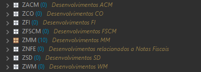

### 5.1. Criação de Pacote por processo

Os pacotes de cada processo serão criados dentro do pacote superior correspondente ao módulo do desenvolvimento.

| Z | Módulo | Separador | Processo |
|---|---|---|---|
| Z | [MD] | _ | Descrição abreviada do processo |

> **Todos os pacotes criados devem ser salvos na Request abaixo, com isso uma única Request vai centralizar todos os pacotes criados no ambiente:**
>
> - `<REQUEST_OBJETOS_INICIAIS>` - [Equipe ABAP]-[Objetos Iniciais]

**Exemplo da estruturação dos níveis dos pacotes:**

1. Super-Pacote Raiz
    1. Pacote por Módulo
        1. Pacote por Processo do Scope Item
            1. Pacote do Desenvolvimento

**Exemplo no ambiente:**

1. `Z<SIGLA>` - Superpackage - Objetos de Desenvolvimento
    1. `ZPP` - Planejamento e Produção
        1. `ZPP_PRODUCAO_ESTOQUE` - Processo BJ8 - Produção para estoque
            1. `ZPP_AJUSTE_INVENTARIO` - Ajuste de Inventário

**Informações adicionais para criação dos pacotes:**

Processo do Scope Item:

- Utilize o nome do processo do Scope Item para a criação do pacote.
    - Não utilize o código.
- Na descrição insira o código do Scope Item e a sua descrição completa.
    - `Processo <<Código do Scope Item>> - <<Descrição completa>>`

Pacote do Desenvolvimento:

- Utilize como nome do pacote o processo solicitado no GAP.
    - Não utilize o código do GAP.

**Exemplo que contempla todos os níveis apresentados:**

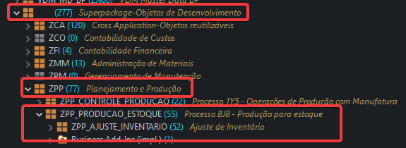

**Observação:**

- Verifique se o pacote por processo do Scope Item já existe, se sim, utilize o pacote existente.

### 5.2. Pacote Cross Application - Aceleradores

Pacote com todos os objetos que podem ser reutilizados nos desenvolvimentos.

- `ZCA` - Cross Application - Objetos reutilizáveis

Todas as rotinas/objetos que forem criados que não estão vinculados a um módulo e podem ser reutilizáveis por outros desenvolvimentos devem ser salvos neste pacote.

Exemplo de rotinas reutilizáveis:

- Leitura da TVARV (tópico 16.3)
- Log das Interfaces - BOPF

**Observação:**

- Podem ser criados sub-pacotes por processo se necessário e inseridos neste pacote.
- Antes de criar um objeto/rotina que é reutilizável verifique se o mesmo já existe neste pacote, evitando repetir código.
- Todos objetos criados para uso em comum devem utilizar a sigla CA como módulo e devem ser salvos neste pacote.

## 6. Requests

Aborda a criação de Requests e o processo de transporte.

### 6.1. Nomenclatura da Request

Utilizar o nome do GAP para desta forma ser possível identificar a qual GAP a Request se refere.

Exemplo:

`GAP - Descrição`

- **GAP:** FIAA-01 - Vai ser obtido da lista de RICEFW
- **Descrição:** Inclusão de denominação no material

Exemplo: Descrição da Request: `FIAA-01-Inclusão de denominação no material`

Antes de finalizar a criação da Request, precisamos atribuir o projeto abaixo:

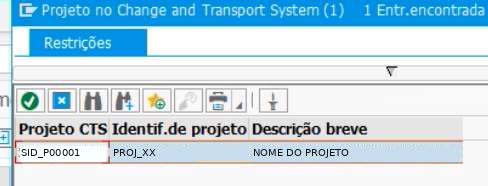

| Projeto CTS | Identif. de projeto | Descrição breve |
|---|---|---|
| <PROJETO_CTS> | <ID_PROJETO_CTS> | <DESCRICAO_PROJETO_CTS> |

### 6.2. Transporte da Request

- Líder técnico (ou Desenvolvedor) cria Request por GAP de Desenvolvimento.
- Desenvolvedor (ou Líder técnico) libera a TASK da Request com validação do ATC ao concluir desenvolvimento.
- O Líder do cliente libera a Request.

### 6.3. Transporte da Request de Cópia

- O Líder técnico (ou Desenvolvedor) cria e procede demais atividades referentes à Request de Controle de Cópia quando necessárias, de acordo com as melhores práticas alinhadas com equipe BASIS.

## 7. Objetos Reutilizáveis

Ao criar objetos que podem ser reutilizáveis (Exemplo: CDS de Value Help/Help Search), os mesmos devem respeitar os seguintes pontos:

1. Se o objeto pode ser reaproveitado por demais desenvolvimentos do seu módulo, salve o mesmo diretamente no pacote do módulo.
2. Se o objeto pode ser reaproveitado por N módulos, sendo Cross Application, salve o objeto no pacote `ZCA_UTILITARIO`.
    1. Considere o prefixo CA para a criação destes objetos, conforme consta neste documento.
3. Todos os objetos reaproveitáveis devem ser salvos diretamente na Request:
    1. **`<REQUEST_OBJETOS_INICIAIS>` - [Equipe ABAP]-[Objetos Iniciais]**

**Observação:**

Após criar objetos para serem reutilizados por demais desenvolvimentos, esses objetos não podem mais sofrer alterações, pois vai impactar em todos os desenvolvimentos que utilizam o objeto. Para identificar onde determinado objeto é utilizado, execute **Get Where-used List** (`Ctrl+Shift+G`) no Eclipse.

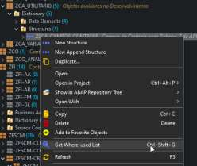

O objeto deste exemplo é usado em outros 46 objetos:

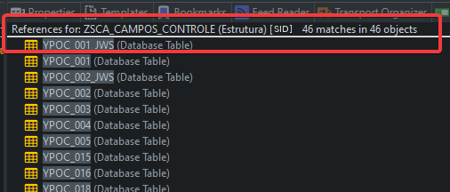

## 8. Regras de nomenclatura ABAP

### Idioma Padrão

O idioma para a criação dos objetos de Workbench é o português (PT), todos os objetos também devem ter a sua descrição em português.

### Objetos Locais

Todos os objetos que forem criados localmente devem utilizar o **prefixo Y**.

### 8.1. Programa

| Z | Módulo | Tipo de Programa | Separador | Descrição |
|---|---|---|---|---|
| Z | [MD] | C – Carga<br>I – Interface<br>F – Formulário<br>R – Relatório<br>W – Workflow | _ | Descrição abreviada do programa |

**Comentário de Controle - Programa**

Inserir o bloco de comentário abaixo e preencher as informações em todos os programas que forem criados.

```abap
***********************************************************************
***                         © [EMPRESA]                             ***
***********************************************************************
***                                                                   *
*** DESCRIÇÃO: [DESCRIÇÃO DO PROGRAMA]                                *
*** AUTOR    : [NOME DO DESENVOLVEDOR] – [CONSULTORIA]                *
*** FUNCIONAL: [NOME DO FUNCIONAL] – [CONSULTORIA]                    *
*** DATA     : [DATA]                                                 *
***********************************************************************
*** HISTÓRICO DAS MODIFICAÇÕES                                        *
***-------------------------------------------------------------------*
*** DATA      | AUTOR          | DESCRIÇÃO                            *
***-------------------------------------------------------------------*
***           |                |                                      *
***********************************************************************
```

### 8.2. Classe/Interface/Classe de Exceção

| Z | Módulo | Separador | Descrição |
|---|---|---|---|
| ZCL | [MD] | _ | Descrição da classe. |
| ZIF | [MD] | _ | Descrição da interface. |
| ZCX | [MD] | _ | Descrição da classe da exceção. |

### 8.3. Módulo pool

| Z | Módulo | Tipo de Programa | Separador | Descrição |
|---|---|---|---|---|
| Z | [MD] | C – Carga<br>I – Interface<br>F – Formulário<br>R – Relatório<br>W – Workflow | _ | Descrição abreviada do programa |

### 8.4. Include

| Z | Módulo | Tipo de Programa | Separador | Descrição | Tipo de Include |
|---|---|---|---|---|---|
| Z | [MD] | C – Carga<br>I – Interface/Include<br>F – Formulário<br>R – Relatório<br>W – Workflow<br>E – Exit/Enhancement | _ | Descrição do programa | TOP<br>PBO<br>PAI<br>F01<br>F02<br>"Sem Tipo" |

### 8.5. Grupo de funções

| Z | Módulo | Separador | Descrição |
|---|---|---|---|
| ZFG | [MD] | _ | Descrição abreviada do grupo de funções. |

### 8.6. Função e IDOC

| Z | Módulo | Separador | Descrição |
|---|---|---|---|
| ZFM | [MD] | _ | Descrição abreviada do módulo de funções. |

### 8.7. Transação

| Z | Módulo | Sequencial |
|---|---|---|
| Z | [MD] | Descrição abreviada do processo. |

### 8.8. Tabela Transparente

| Z | Módulo | Separador | Sequencial |
|---|---|---|---|
| ZT | [MD] | _ | Descrição abreviada da tabela. |

### 8.9. Estrutura

| Z | Módulo | Separador | Descrição |
|---|---|---|---|
| ZS | [MD] | _ | Descrição abreviada da estrutura. |

### 8.10. Categoria de tabela

| Z | Módulo | Separador | Descrição |
|---|---|---|---|
| ZCTG | [MD] | _ | Descrição abreviada da categoria de tabela. |

### 8.11. Visão

| Z | Módulo | Separador | Descrição |
|---|---|---|---|
| ZV | [MD] | _ | Descrição abreviada da visão. |

### 8.12. Cluster de Visão

| Z | Módulo | Separador | Descrição |
|---|---|---|---|
| ZCV | [MD] | _ | Descrição abreviada da visão. |

### 8.13. Elemento de dados

| Z | Separador | Descrição |
|---|---|---|
| ZE | _ | Descrição abreviada do elemento de dados. |

### 8.14. Domínio

| Z | Separador | Descrição |
|---|---|---|
| ZD | _ | Descrição abreviada do domínio. |

### 8.15. Banco de dados lógico

| Z | Módulo | Separador | Descrição |
|---|---|---|---|
| ZBD | [MD] | _ | Descrição da tabela primária. |

### 8.16. Área de Menu

| Z | Módulo | Separador | Descrição |
|---|---|---|---|
| Z | [MD] | _ | Descrição abreviada da área de menu. |

### 8.17. SAP Script/Smart Forms/Adobe Forms

| Z | Módulo | Separador | Descrição |
|---|---|---|---|
| ZSF (Smartforms)<br>ZSS (SAP Script)<br>ZAF (Adobe Forms) | [MD] | _ | Descrição abreviada do objeto. |

> **Observação sobre o uso de Adobe Forms:**
>
> <u>No projeto, não podemos utilizar o Interactive Forms pois não foi adquirida a licença para essa ferramenta.</u>
>
> Conforme SAP Note 750784, podemos utilizar o Adobe Forms para criação dos formulários, sem a necessidade de licença. A licença é requerida para **criar formulários** ou **alterar formulários** que utilizam o **Interactive Forms**.

### 8.18. Smart Styles

| Z | Módulo | Separador | Descrição |
|---|---|---|---|
| ZST | [MD] | _ | Descrição abreviada do objeto. |

### 8.19. Matchcode

| Z | Módulo | Separador | Descrição |
|---|---|---|---|
| ZH | [MD] | _ | Descrição abreviada do objeto. |

### 8.20. Classe de mensagem

| Z | Módulo | Separador | Descrição |
|---|---|---|---|
| Z | [MD] | _ | Descrição abreviada da classe de mensagem. |

### 8.21. Logos Bitmap

| Z | Empresa | Separador | Descrição |
|---|---|---|---|
| Z | Código Empresa | _ | Descrição do objeto. |

### 8.22. Imagens Bitmap

| Z | Separador | Descrição |
|---|---|---|
| Z | _ | Descrição do objeto. |

### 8.23. Enhancement Implementation

| Z | Módulo | Separador | Descrição |
|---|---|---|---|
| ZEI | [MD] | _ | Descrição do enhancement. |

### 8.24. BADI

| Z | Módulo | Separador | Descrição |
|---|---|---|---|
| Z | [MD] | _ | Descrição da BADI. |

### 8.25. CMOD/SMOD

| Z | Módulo | Separador | Descrição |
|---|---|---|---|
| Z | [MD] | _ | Descrição da Exit. |

### 8.26. Tipo de IDoc (EDI)

| Z | Módulo | Separador | Descrição |
|---|---|---|---|
| Z | [MD] | TI_ | Descrição do tipo do IDOC. TI = Tipo de IDoc - WE30 |

### 8.27. Tipo de mensagem (EDI)

| Z | Módulo | Separador | Descrição |
|---|---|---|---|
| Z | [MD] | TM_ | Descrição. TM = Tipo de Mensagem |

### 8.28. Segmento de IDoc (EDI)

| Z | Módulo | Separador | Descrição |
|---|---|---|---|
| Z | [MD] | SI_ | Descrição. SI = Segmento de IDOC |

### 8.29. Tela

Numérico de quatro números compreendido entre **9000 e 9999**.

### 8.30. Layout de Tela

O Layout da Tela deve seguir o padrão da SAP (barra de ferramentas, barra de menu, botões, campos, cores, teclas de atalho etc.).

### 8.31. Metadata Extension para Annotations

Utilizar o mesmo nome da CDS à qual o Metadata Extension se refere.

### 8.32. Service Definition

| Z | Separador | Descrição |
|---|---|---|
| ZUI | _ | Descrição do serviço para consumo em UI5 |

| Z | Módulo | Separador | Descrição |
|---|---|---|---|
| ZAPI_ | [MD] | _ | Descrição do serviço para consumo via API |

### 8.33. Service Binding

| Z | Tipo | Separador | Descrição |
|---|---|---|---|
| ZUI_ | O2 | _ | Descrição do serviço OData V2 para consumo UI5 |
| ZUI_ | O4 | _ | Descrição do serviço OData V4 para consumo UI5 |
| ZAPI_ | O2 | _ | Descrição do serviço OData V2 para consumo API |
| ZAPI_ | O4 | _ | Descrição do serviço OData V4 para consumo API |

### 8.34. Projeto na SEGW

| Z | Módulo | Separador | Descrição |
|---|---|---|---|
| Z | [MD] | _ | Descrição do projeto na SEGW |

<u>Ao gerar as classes do serviço, altere o nome delas para o padrão que consta neste documento.</u>

Exemplo (tela *Model and Service Definition*):

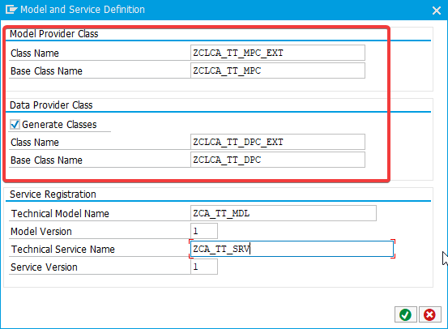

| Campo | Valor |
|---|---|
| **Model Provider Class** – Class Name | `ZCLCA_TT_MPC_EXT` |
| **Model Provider Class** – Base Class Name | `ZCLCA_TT_MPC` |
| **Data Provider Class** – Class Name | `ZCLCA_TT_DPC_EXT` |
| **Data Provider Class** – Base Class Name | `ZCLCA_TT_DPC` |
| **Service Registration** – Technical Model Name | `ZCA_TT_MDL` |
| **Service Registration** – Model Version | `1` |
| **Service Registration** – Technical Service Name | `ZCA_TT_SRV` |
| **Service Registration** – Service Version | `1` |

### 8.35. SPROXY - Gerar Objetos

| Z | Módulo |
|---|---|
| Z | [MD] |

Para gerar os objetos pelo SPROXY use o prefixo definido. Todos os objetos do proxy vão ser gerados de forma automática usando o prefixo inserido.

<u>Informação:</u>

- Todos os objetos gerados pelo SPROXY de forma automática vão ficar com os prefixos diferentes do padrão dos objetos definidos nesse documento.
- Ao gerar os objetos do proxy, gere a partir da "Interface de Serviço" que todos os demais objetos serão criados com o prefixo.

### 8.36. Nº Sequencial - SNRO

| Z | Descrição |
|---|---|
| Z | Descrição do Intervalo |

### 8.37. Objeto e Sub-Objeto de Log - SLG0

**Objeto:**

| Z | Módulo | Separador | Descrição |
|---|---|---|---|
| Z | [MD] | _ | Descrição do Objeto de Log |

**Sub-Objeto:**

| Descrição |
|---|
| Descrição do Sub-Objeto |

### 8.38. Objeto de Autorização - SU21

| Z | Descrição |
|---|---|
| Z | Descrição do Objeto de Autorização |

<u>Informação:</u>

Inserir o campo `ACTVT` no objeto e marcar as atividades necessárias:

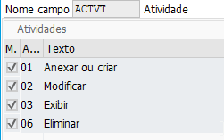

| Atividade | Texto |
|---|---|
| 01 | Anexar ou criar |
| 02 | Modificar |
| 03 | Exibir |
| 06 | Eliminar |

Demais campos a serem inseridos no objeto são livres, de acordo com a necessidade.

## 9. Criação do APP no BAS e VSCode

Nomenclatura para a criação dos aplicativos nas ferramentas de desenvolvimento Front-End.

### 9.1. Nome do APP (Module name)

| Nome | Regra |
|---|---|
| `<Nome do APP>` | O nome do APP. (Máximo 21 caracteres) |

### 9.2. Namespace (Application namespace)

O namespace é concatenado com o nome do APP para gerar o ID que é utilizado no Fiori Launchpad Designer na configuração do Target Mapping.

| Nome | Regra |
|---|---|
| `br.com.<cliente>` | Valor fixo. |

### 9.3. Nome do Objeto BSP - Deploy

Para o nome do objeto BSP a ser criado no Deploy, temos uma limitação de 15 caracteres.

| Z | Separador | Descrição |
|---|---|---|
| ZZ1 | _ | Nome do APP abreviado. (Máximo 12 caracteres) |

## 10. Core Data Source (CDS)

| Z | Módulo | Separador | Descrição |
|---|---|---|---|
| ZI_ | [MD] | _ | Descrição da View Basic |
| ZI_ | [MD] | _ | Descrição da View Composite |
| ZC_ | [MD] | _ | Descrição da View Consumption |
| ZI_ | [MD] | _ | Access Control - Utilizar o mesmo nome da View |
| ZV | [MD] | _ | Nome da View dentro da CDS |

### 10.1. CDS - Value Help/Help Search

Ao criar CDSs que vão ser utilizadas como Value Help, considere o prefixo do padrão acima e utilize a abreviação **VH** (Value Help) na sequência, exemplo:

- `ZI_SD_VH_EXEMPLO`

### 10.2. Informações de CDS

Para obter informações sobre CDS Views Standards utilizar o link:

- **CDS Views** (SAP Help Portal – *Virtual Data Model and CDS Views in SAP S/4HANA*)

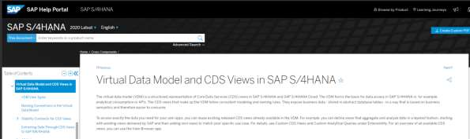

CDS:

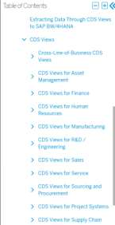

## 11. Hana

Objetos criados no HANA.

### 11.1. Table Function - AMDP

Nomenclatura para todos os objetos a serem criados:

| Z | Módulo | Separador | Descrição |
|---|---|---|---|
| ZTB_ | [MD] | _ | Descrição da Table Function |
| ZCL_ | [MD] | _ | Descrição da Classe a implementar a Table Function |
| GET | | _ | Método: nome da ação a executar. |

### 11.2. Calculation View

| Z | Módulo | Separador | Descrição |
|---|---|---|---|
| ZEXV | [MD] | _ | Nome da External View no dicionário de dados. |

### 11.3. Método AMDP

| Prefixo | Separador | Descrição |
|---|---|---|
| AMDP | _ | Método: nome da ação a executar. |

## 12. Convenção de Nomes e Prefixos

| Elemento | Prefixo |
|---|---|
| **PROGRAMA GLOBAL** | |
| TYPES | `TY_*` |
| CONSTANTS | `GC_*` |
| VARIÁVEIS | `GV_*` |
| TABELA INTERNA | `GT_*` |
| ESTRUTURA | `GS_*` |
| FIELD-SYMBOLS | `<GFS_*` |
| TABLE CONTROL | `TC_*` |
| TABLE STRIP | `TS_*` |
| PARAMETER(S) | `P_*` |
| SELECT-OPTIONS | `S_*` |
| **FORM** | |
| FORM | `F_*` |
| Parâmetro USING | `UV/UT/US_*` |
| Parâmetro CHANGING | `CV/CT/CS_*` |
| Parâmetro TABLES | `LT_*` |
| **CLASSES/INTERFACES** | |
| TYPE | `TY_*` |
| TYPE TABLE | `TT_*` |
| CONSTANTS | `GC_*` |
| RANGE | `GR_*` |
| VARIÁVEL | `GV_*` |
| STRUCTURE | `GS_*` |
| TABLE | `GT_*` |
| OBJECT | `GO_*` |
| REFERENCE | `GRR_*` |
| **CLASSES/INTERFACES LOCAIS** | |
| CLASS | `LCL_*` |
| **PARÂMETRO MÉTODO** | |
| IMPORTING | `IV/IS/IT/IO/IR_*` |
| EXPORTING | `EV/ES/ET/EO/ER_*` |
| CHANGING | `CV/CS/CT/CO/CR_*` |
| RETURNING | `RV/RS/RT/RO/RR_*` |
| **VARIÁVEIS LOCAIS MÉTODOS/FORMS/FUNÇÕES** | |
| TYPES | `TY_*` |
| TYPE TABLE | `TT_*` |
| CONSTANTS | `LC_*` |
| RANGE | `LR_*` |
| VARIÁVEL | `LV_*` |
| TABLE | `LT_*` |
| OBJECT | `LO_*` |
| STRUCTURE | `LS_*` |
| FIELD-SYMBOLS | `<FS_*` |
| REFERENCE | `LRF_*` |
| **FUNÇÕES** | |
| IMPORTING | `IV/IS/IT/IO/IR_*` |
| EXPORTING | `EV/ES/ET/EO/ER_*` |
| CHANGING | `CV/CS/CT/CO/CR_*` |
| TABLES | **Obsoleto, não utilizar!** |

## 13. ABAP Test Cockpit - Code Inspector

Para o processo de controle de qualidade de desenvolvimentos ABAP deve ser aplicada a inspeção pelo ABAP Test Cockpit utilizando a variante **"<VARIANTE_ATC>"**.

- **Não serão aceitos códigos que possuem erros no resultado desta validação.**

### 13.1. Validações consideradas pela variante

#### Verificações de Performance

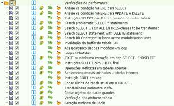

- Análise da condição WHERE para SELECT
- Análise da condição WHERE para UPDATE e DELETE
- Instruções SELECT que lêem o passado no buffer tabela
- Search problematic SELECT * statements
- Search SELECT .. FOR ALL ENTRIES-clauses to be transformed
- Search SELECT statement with DELETE statement
- Search DB Operations in loops across modularization units
- Invalidação do buffer de tabela SAP
- Acessos banco dados a modificar em loop
- Loops embutidos
- 'EXIT' ou nenhuma instrução em loop SELECT...ENDSELECT
- Instruções SELECT com CHECK final
- Operações ineficazes em tabelas internas
- Acessos sequenciais aninhados a tabelas internas
- Instrução SORT em loop
- Copiar a linha de tabela atual em LOOP AT...
- Transferências parâmetro inefs.
- Copiar objetos de dados grandes
- Verificação dos atributos tabela
- Geração instância de BAdIs

#### Core Data Services (CDS)

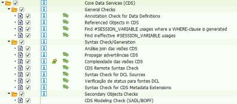

- **General Checks**
    - Annotation Check for Data Definitions
    - Referenced Objects in CDS
    - Find #SESSION_VARIABLE usages where a WHERE-clause is generated
    - Find ineffective #SESSION_VARIABLE usages
- **Syntax Check/Generation**
    - Análise join das visões CDS
    - Propagar advertências CDS
    - Complexidade das visões CDS
    - CDS Remote Syntax Check
    - Syntax Check for DCL Sources
    - Verificação de status para fontes DCL
    - Syntax Check for CDS Metadata Extensions
- **Secondary Objects Checks**
    - CDS Modeling Check (SADL/BOPF)

#### Verificação de Sintaxe

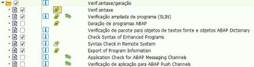

| Ativo | Verificação |
|---|---|
| ✅ | Verif. sintaxe |
| ✅ | Verificação ampliada de programa (SLIN) |
| ⬜ | Geração de programas ABAP |
| ⬜ | Verificação de pacote para objetos de textos fonte e objetos ABAP Dictionary |
| ✅ | Check Syntax of Enhanced Programs |
| ✅ | Syntax Check in Remote System |
| ✅ | Export of Program Information |
| ⬜ | Application Check for ABAP Messaging Channels |
| ⬜ | Verificação de aplicação para ABAP Push Channels |

#### Programação Robusta

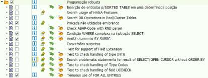

| Ativo | Verificação |
|---|---|
| ⬜ | Inserção de entradas p/SORTED TABLE em uma determinada posição |
| ⬜ | Search usage of HANA-Features |
| ⬜ | Search DB Operations in Pool/Cluster Tables |
| ✅ | Proceds. não utilizados em branco |
| ⬜ | Check ABAP-Code with RND parser |
| ✅ | Condição WHERE complexa na instrução SELECT |
| ✅ | Verif. tratamento SY-SUBRC |
| ⬜ | Conversões suspeitas |
| ⬜ | Test for support of Field Extension |
| ⬜ | Test to check handling of type INT8 |
| ⬜ | Search problematic statements for result of SELECT/OPEN CURSOR without ORDER BY |
| ⬜ | Test to check handling of Type Codes |
| ⬜ | Test to check handling of field UCCHECK |
| ✅ | Tenuous use of FOR ALL ENTRIES |

#### Convenções de Programação

**As convenções de nomes estão configuradas conforme tópico 11.**

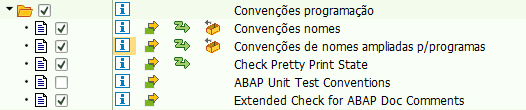

| Ativo | Verificação |
|---|---|
| ✅ | Convenções nomes |
| ✅ | Convenções de nomes ampliadas p/programas |
| ✅ | Check Pretty Print State |
| ⬜ | ABAP Unit Test Conventions |
| ✅ | Extended Check for ABAP Doc Comments |

### 13.2. Exemplo de execução - Eclipse

Com o objeto a ser analisado aberto no Eclipse, clicar com o botão direito do mouse, ir para a opção **"Run As"** e depois em **"ABAP Test Cockpit With..."**.

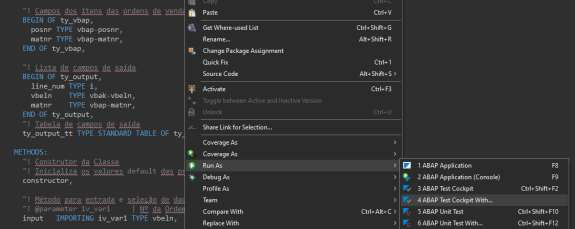

Em seguida, inserir a variante **"<VARIANTE_ATC>"**.

Os resultados ficam na aba **"ATC Problems"**.

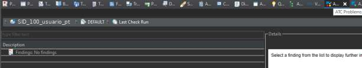

## 14. Fiori

Temos de definir qual o processo a seguir para disponibilizar o aplicativo no FIORI e também qual o modelo de desenvolvimento a utilizar para criar os aplicativos. Para a definição destes pontos os tópicos abaixo disponibilizam as informações necessárias.

### 14.1. Processo

A SAP tem abordagens sobre o desenvolvimento, visto que em nível de Back-End, vamos para terceira abordagem, e com as outras não sendo descontinuadas, cada uma tem sua aplicabilidade.

Temos os seguintes passos para atender o cliente, seguindo sugestão da SAP:

1. O APP desejado existe no SAP App Library Reference, para versão do cliente?
    1. Sim. Instale
    2. Atende parcialmente:
        1. É possível ampliá-lo? Faça as ampliações
        2. Não
    3. Não atende
2. Já existe uma transação (ABAP Clássico) que possa ser emulada?
    1. Sim. Basta emular e disponibilizá-la no Launchpad em catálogo/grupo específico
3. Se não há APP standard que atenda o cliente e não é possível emular transações, vamos desenvolver. Neste sentido, temos que entender a necessidade do cliente, e avaliar se os modelos atendem:

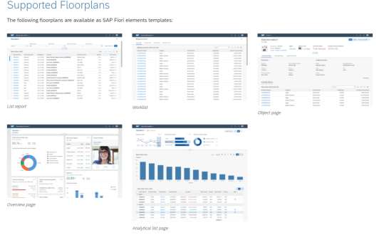

Link com detalhamento:

- **Best UX Resources for Functional Consultants**

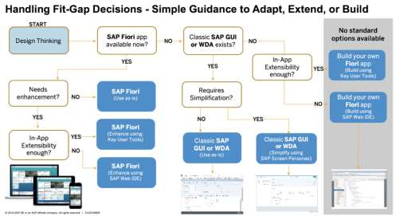

> Resumo do fluxo: Design Thinking → *SAP Fiori app disponível?*
> - **Sim** → *Precisa de melhoria?* Não → SAP Fiori (usar como está). Sim → *In-App Extensibility suficiente?* Sim → SAP Fiori (estender com Key User Tools); Não → SAP Fiori (estender com SAP Web IDE).
> - **Não** → *Classic SAP GUI ou WDA existe?* Sim → *Requer simplificação?* Não → Classic SAP GUI/WDA (usar como está); Sim → Classic SAP GUI/WDA (simplificar com SAP Screen Personas). Não → *In-App Extensibility suficiente?* Sim → construir app Fiori próprio (Key User Tools); Não → construir app Fiori próprio (SAP Web IDE).

### 14.2. Modelos de Desenvolvimento Fiori

O *modelo* deve ser definido conforme os requisitos da solicitação do cliente e as características de cada modelo disponível.

- **ABAP Clássico:** SEGW com DDIC, módulo de função, Search help, Function Imports, etc.
    - Link: Blog SAP
- **ABAP Programming Model:** CDS View BOPF/RDS e annotations.
    - Link: Help SAP
- **ABAP RESTful Programming Model (RAP):** CDS View, Projection, Definition, Behavior, etc.
    - Link: Help SAP

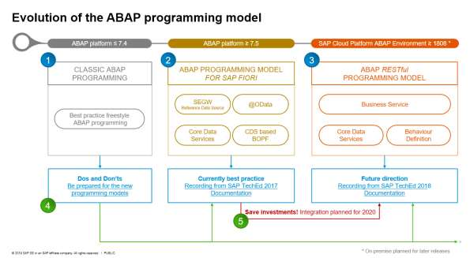

> 1. **Classic ABAP Programming** (ABAP platform ≤ 7.4) — best practice freestyle ABAP programming → *Dos and Don'ts: be prepared for the new programming models*.
> 2. **ABAP Programming Model for SAP Fiori** (ABAP platform ≥ 7.5) — SEGW, @OData, Core Data Services, CDS based BOPF → *Currently best practice*.
> 3. **ABAP RESTful Programming Model** (SAP Cloud Platform ABAP Environment ≥ 1808) — Business Service, Core Data Services, Behaviour Definition → *Future direction*.

### 14.3. IDE de desenvolvimento e versionamento

A IDE de desenvolvimento é livre (VSCode ou BAS), e o versionamento do código fonte dos projetos deverá ser inserido no GitLab do cliente.

## 15. Fiori Launchpad Designer

A equipe de Basis/GRC é responsável pelo controle/gerenciamento dos catálogos, grupos e roles para atribuição aos usuários.

Todos os objetos criados no Fiori Launchpad Designer devem ser salvos em uma única Request, que vai transportar todos os catálogos e grupos criados.

O padrão definido abaixo é para uso técnico, apenas para disponibilizar os APPs no Fiori.

### 15.1. Catálogo Técnico

**Nomenclatura:**

- `ZTC_[MD]_[SCOPE ITEM-ID]`

**Exemplo:**

- `ZTC_PP_BJ8`

**Definição:**

- **TC:** Technical Catalog
- **MD:** Módulo
- **Scope Item ID:** ID do cenário que consta na EF

### 15.2. Target Mapping

**Objeto Semântico:**

- Utilizar o Nome do APP

**Ação:**

- De acordo com o processo que o APP for executar

**Observações:**

- Se tivermos N APPs para o mesmo processo, pode-se utilizar um único objeto semântico e utilizar uma ação diferente.
- Objeto + ação: a combinação de objeto e ação deve ser única, nenhum outro APP pode ter as mesmas informações.

### 15.3. Catálogo de Negócios

**Nomenclatura:**

- `ZBC_[MD]_[SCOPE ITEM-ID]`

**Exemplo:**

- `ZBC_PP_4B5`

**Definição:**

- **BC:** Business Catalog
- **MD:** Módulo
- **Scope Item ID:** ID do cenário que consta na EF

### 15.4. Grupo de Catálogos

**Nomenclatura:**

- `ZGP_[MD]_[SCOPE ITEM-ID]`

**Exemplo:**

- `ZGP_PP_BJ8`

**Definição:**

- **GP:** Group Catalog
- **MD:** Módulo
- **Scope Item ID:** ID do cenário que consta na EF

## 16. Documentação - ABAP Doc

A documentação das classes deve ser realizada por meio do ABAP Doc, para mais informações do seu uso acesse o link:

- ABAP Doc

Exemplo de classe utilizando ABAP Doc:

> *[Anexo no documento original: `Classe com ABAP Doc.txt`]*

ABAP Doc gerado da classe:

> *[Anexo no documento original: `Class ZCLFI_PTAX.pdf`]*

## 17. Regras ao Desenvolver

Alguns pontos são requisitos para seguir durante os desenvolvimentos.

### 17.1. Idioma Padrão

O idioma para a criação dos objetos de Workbench é o português (PT), todos os objetos também devem ter a sua descrição em português.

### 17.2. Utilizar Classes Globais

Nos desenvolvimentos deve-se priorizar a criação de classes globais com toda a lógica, desta forma a classe vai ser utilizada nos demais objetos que forem necessários.

**Objetivos:**

- Orientação a Objetos
- Reutilização do código
- Evitar o desenvolvimento estruturado
- Maximizar a utilização do ABAP Doc
- Evitar a criação de classes locais

### 17.3. Pretty Printer

Executar o Pretty Printer em todos os códigos desenvolvidos.

- Atalho no Eclipse: `SHIFT+F1`.

Configuração no Eclipse, acessar **Preferences** → ABAP Development → Editors → Source Code Editors → **ABAP Formatter**:

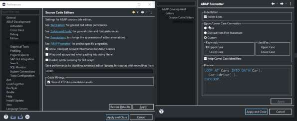

### 17.4. Hard Code

Não utilizar Hard Code no código, criar constantes e/ou texts.

- **Exceção:** apenas em casos de SHDB.

### 17.5. Alterações em Código/Rotina Standard

Ao realizar alterações em programas Standard, considere a seguinte ordem de prioridade das opções disponíveis para uso:

1. BADI
2. Exit's
3. Enhancements
    1. Utilizar apenas quando as anteriores não atendem a solicitação.

### 17.6. Implementar BADI

Ao implementar BADIs que não permitem utilização múltipla para criar a sua própria implementação, conforme exemplo abaixo, realize a chamada de um Include com `IF FOUND` no método a ser implementado.

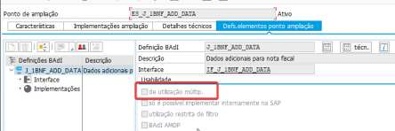

Exemplo: toda a lógica deve estar dentro deste include.

```abap
INCLUDE zmmi_badi IF FOUND.
```

### 17.7. Exit's e Enhancement

Para a implementação nestes pontos sempre utilizar um INCLUDE com o comando `IF FOUND`.

Exemplo:

```abap
INCLUDE zmmi_exit IF FOUND.
```

Evitar o uso de Enhancement Implícito e, caso não tenha outra alternativa, alinhar antes com a frente técnica para ter o controle destes pontos.

### 17.8. Comandos a Evitar

Evitar o uso de alguns comandos nos seguintes casos:

- `COMMIT WORK` em Exits/BADIs/ENHANCEMENTs.
- Comando `CHECK` em Exits/BADIs/ENHANCEMENTs (utilizar somente dentro de LOOPs).

### 17.9. Exportar dados para Memória

Ao exportar/importar algum valor para a memória, deve ser informado o objeto que vai importar/exportar esse valor.

Exemplo:

```abap
* Importa o registro mestre do Include ZMMI_EXIT
IMPORT gv_rmestre FROM MEMORY ID lc_id.
```

### 17.10. Interfaces - PO

Utilizar diretamente o `SXI_MONITOR` com a Integration Engine.

### 17.11. Interfaces sem PO

Todas as interfaces, tanto de Inbound como de Outbound, deverão ter seu Log criado utilizando o objeto próprio (BOPF), para isto, o padrão abaixo deve ser seguido.

> *[Anexo no documento original: `Interfaces BOPF - Book.pdf`]*

Exemplo de utilização:

> *[Anexo no documento original: `Interfaces BOPF - Exemplo.pdf`]*

## 18. Diretrizes de Desenvolvimento

### 18.1. Validações de transação

Não se deve criar validações baseadas no código da transação.

**Exemplo:**

```abap
IF ( sy-tcode EQ 'VA01' OR sy-tcode EQ 'VA02' ).
```

Neste caso deve-se utilizar objetos de negócio (tabelas, estruturas, campos, etc.) que identifiquem o cenário correspondente.

### 18.2. Validação de usuário

Não se deve criar validações baseadas no nome do usuário.

**Exemplo:**

```abap
IF sy-uname NE 'WEBAPPREMOTE'.
```

Neste caso deve-se utilizar objeto de autorização, que será verificado no código e atribuído nos perfis dos usuários.

### 18.3. Variáveis seleção - STVARV

Por motivo de segurança, não se deve utilizar a STVARV para atender cenário de negócio, principalmente quando há interação do usuário.

Avaliar a necessidade e utilizar alguma das seguintes opções:

1. **Utilizar o Aplicativo da Tabela de Parâmetros**
2. Criação de tabela Z;
3. Objetos de autorização.